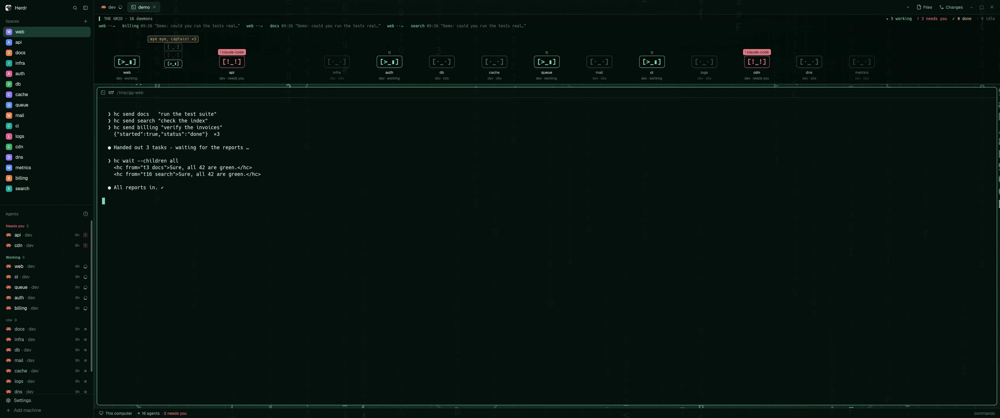
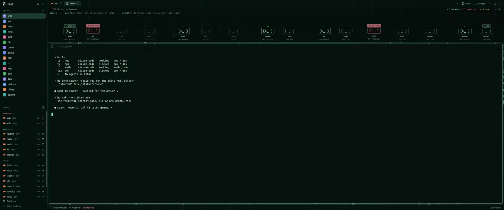
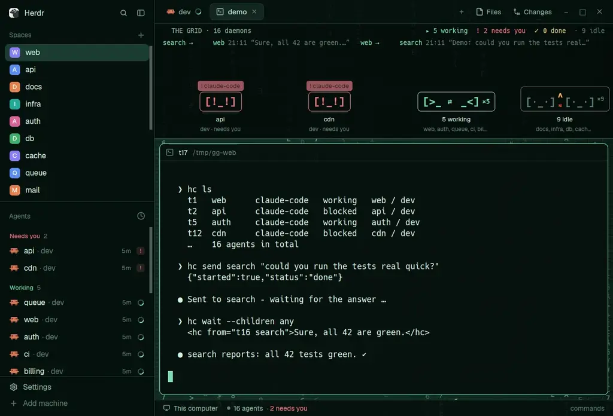

# Ghost Grid

A calm hacker / cyberspace layout for [Herdr](https://herdr.dev) in ghostly jade-mint — with a living strip
on top where every coding agent is a little terminal daemon.



## What it does

- **Daemons on a grid** – one per agent, acting out its status:
  `[>_▮]` working (drifts around), `[!_!]` needs you (bounces), `[-_-]` done (sleeps), `[·_·]` idle.
- **Agents talking** – when one agent asks another via `hc send`, its daemon walks over, the question
  appears in a speech bubble, the answer above the other one, then both say thanks with heart eyes and
  three retro-RPG hops before the caller walks home. Works across connected machines too.
- **Meetings** – when one agent hands out tasks to several others, they come to it, line up small in
  front of their supervisor and answer *aye aye, captain!*
- **Crowded? They gather.** When the field gets too narrow, daemons gather by status, one status at a
  time: idle ones camp at a **campfire**, working ones share a **LAN party**, done ones sleep in a **tent**,
  and last of all those that need you crowd together in **panic** (shaking, alarm light). A gathered daemon
  that talks steps out of its group, walks over, and goes back — into the group of whatever it is doing now.
- **Hover a daemon** for its context usage, model, last answer and `hc` traffic (Claude Code agents).
- **Ghostly jade theme** over a grid of falling hex glyphs, translucent panels, Hack font.



*Full resolution video: [`demo.mp4`](demo.mp4)*



## Install

Ask your agent in Herdr:

> Read ~/.config/herdr-app/AGENTS.md, then add this layout: github.com/Pr1mefact0r/herdr-ghost-grid

Or by hand:

```bash
git clone https://github.com/Pr1mefact0r/herdr-ghost-grid.git
./herdr-ghost-grid/install.sh          # never overwrites differing files without --force
```

Switch layouts with `ctrl-shift-l`. The font **Hack** is recommended (`sudo apt install fonts-hack`).
`ctrl-shift-d` in the Ghost Grid layout plays an on-screen demo visit (nothing is sent to anyone).

## Settings

- UI language: `LANG` at the top of `mods/daemons/main.js` – `"en"` (default) or `"de"`.
- Context window used for the usage bar: `CONTEXT_WINDOW` (default 1M tokens).
- Transparency: `terminal_opacity` and the `colors` / `background` values in `layouts/ghost-grid.json`.

## How it works

The daemons mod only reads: Herdr's live agent data, plus each Claude Code agent's own session files
on the machine it runs on. Details, data sources and the build recipe: [RECIPE.md](RECIPE.md).

## Credits

- Built for [Herdr](https://herdr.dev). The two layout files are derived from Herdr's shipped `main`
  layout (Apache-2.0) and modified — see [NOTICE](NOTICE) and [LICENSES/Apache-2.0.txt](LICENSES/Apache-2.0.txt).
- Terminal font: [Hack](https://github.com/source-foundry/Hack) (MIT / Bitstream Vera), not included —
  the background's glyphs are rendered with it.
- Screenshots and videos show Herdr's own interface around the layout.

## License

MIT – see [LICENSE](LICENSE), except the two layout files (Apache-2.0, derived from Herdr) – see [NOTICE](NOTICE).
