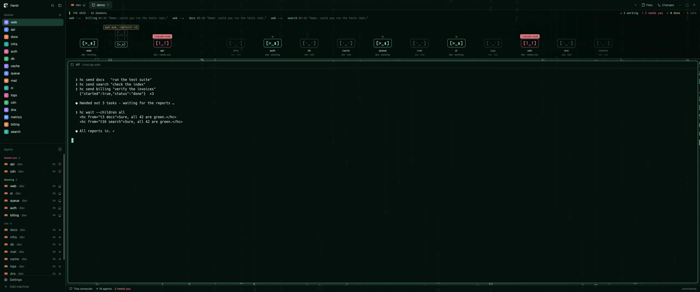
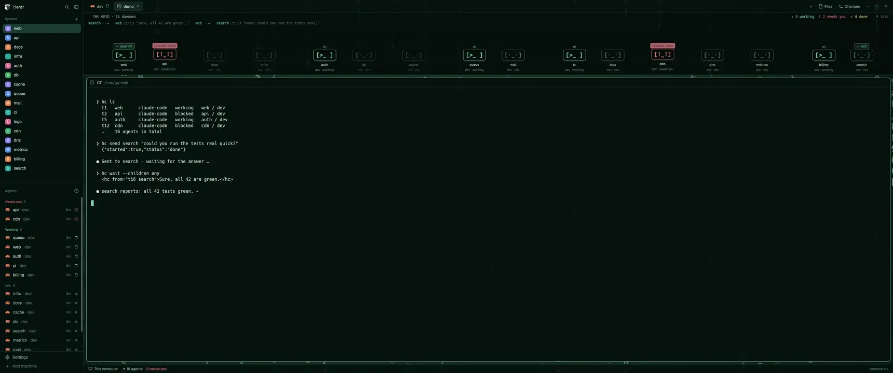
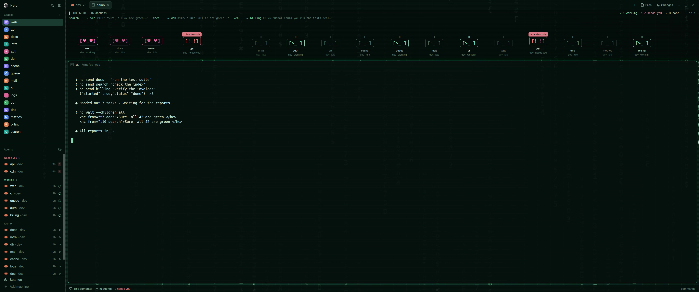

# Ghost Grid

A calm hacker / cyberspace look for Herdr in ghostly jade-mint with a living strip on top: every agent is a small terminal
daemon on a grid that acts out its status, shows its context usage on hover, and — when agents talk
through `hc send` — walks over to the one it asks, waits for the answer in a speech bubble, thanks it
with heart eyes and three retro-RPG hops, and walks home.

*The full visit as video: [`demo.mp4`](demo.mp4) (23 s, 3440×1440).*

## What you see

Left to right, top to bottom (the `main` layout's structure, restyled):

- **Background**: `backgrounds/ghost-grid.jpg` (2560×1440), dark green-grey with a 48 px grid, falling
  hex glyph columns in jade and faint scanlines, `fit: cover`. It shows through everything.
- **Sidebar** (268 px, spaces + agents + footer, shipped mods) on `#05100cb0`, **tab bar** (42 px) and
  **status bar** (28 px) transparent over `chrome` = `#05100ce6`.
- **THE GRID** (block `grid`, 200 px, min 120, max 400, background `#05100cb0`) above the terminals, mod `daemons`:
  - header row (24 px, Hack 11): blinking `▌`, `THE GRID · N daemons`, right: counts
    `▸ working  ! needs you  ✓ done  · idle` in the status colors;
  - ticker row (18 px): the last three `hc` messages of the last 30 min, `from ⇢ to HH:MM „text…“`,
    a live one (< 90 s) in accent with a moving packet `···⇢`;
  - the field: one slot per daemon, each daemon absolutely placed (`left` = slot centre) so every change
    of place animates; a newly shown element starts where it comes from (its group), never from x = 0.
    When slots get narrower than 130 px, daemons **gather by status**, one status at a time until it fits:
    idle → campfire `[·_·] ʌ [-_-] ×N`, working → LAN party `[>_ ⇄ _<] ×N`, done → tent `/\ zZ ×N`,
    and last blocked → panic `◉ [°□°] !! ×N` (faces flipping, alarm light, shaking). Groups sit at the right
    end (blocked, working, done, idle), show `N <status>` and names, hover lists them, click focuses the
    first. Visits never change which groups exist. Still too narrow → every daemon shrinks (face 18→11 px).
    A daemon is a
    120 px column: note line (16 px), face box (Hack Bold 18, 1 px border in the status color,
    rounded 6), a 64×2 px context meter, space name (11) and `tab · status` (10, dim).
- **Terminals**: the active tab's panes as cards (radius 8, gap 8, border `#1d3a30`, focus 1 px accent),
  pane background `#040d0aa6`, `terminal_opacity` 0.72, terminal font Hack.
- **Files / Changes** panel on the right (shipped mods) on `#05100cb0`.

Theme `themes/ghost-grid.json` (taken from glowing jade jewellery): accent `#7ddcb4`, glow/ring
`#b0f2d7`, text `#d2efe3`, muted `#92b8a8`, dim `#5c7d70`, border `#1d3a30`, done `#d9cf8c`,
blocked `#e07b86`; layout overrides `chrome #05100ce6`, `background #07110ed9`.

## How it behaves

Daemon faces (native `.frames`, motion with native `.loop`/`.transition`, no timers for animation):

| status | face | motion | note line |
|---|---|---|---|
| working | `[>_ ]` ↔ `[>_▮]` | drifts left/right ±40–70 px, 5–8 s | `01 10 11 00` |
| blocked | `[!_!]` / `[°□°]` red | bounces 12 px, 520 ms | red pill `! <app>` pulsing |
| done | `[-_-]` gold | — | `z zz zzz` |
| idle | `[·_·]` / `[-_-]` dim | opacity breathes 0.45–0.85 | blinking `▮` |

- **Click** a daemon: `agent.focus` on its terminal. `setAgentOrder` follows the field.
- **Hover** (HoverCard, 250 ms): space, address, tab and status; context tokens / window with a bar
  (accent, gold > 50 %, red > 80 %), output tokens, model, last answer, session name, hc sent/received
  and the last message.
- **A visit** (an `hc send` from one agent to another):
  1. a slot is reserved beside the one asked, on the side the caller comes from; everyone slides aside
     (1 s) and stops drifting while anyone talks; then the caller walks there (`transition left`, 2.8 s)
     on a lane 34 px up, over the others' heads, its name hidden, and lands; on the way it only wears a small `⇢ <partner>` tag, the question
     bubble appears once it has arrived (bubbles open inwards at the field's ends). A **gathered** caller stays in its group until the field
     has settled, then rises out of the group in place (0.55 s) and walks straight from there; a gathered one being asked
     steps out in front of its group (they meet there; the meeting point stays put even if its status
     changes meanwhile);
  2. the answer floats above the answerer in a gold bubble for 6 s;
  3. both switch to `[♥_♥]`/`[♥‿♥]` in pink `#ff7ab6` and hop 12 px three times in step (480 ms each);
  4. the caller walks home the same way — a gathered one straight back into its group, and a gathered
     one that was asked back into the group of its status **now** (asked while idle, working afterwards →
     LAN party); the gap stays until the caller has landed, then the field tidies up in one step.
     No answer: it walks home once the one asked is idle/done again (after 8 s), at the latest after 60 s.
  A message counts as an answer only if the other side has an open question (chronological pairing).
- **Guests**: a sender with no daemon on this screen (an unconnected machine) appears as a translucent
  ghost `[◇_◇]` in its own reserved slot beside the one it asks, labelled with its machine and `tN · guest`.
- `ctrl-shift-d` (layout `ghost-grid`) or `herdr-app do daemons.demo` plays a made-up visit between the
  first and last daemon; `daemons.demo-guest` one from a ghost. Nothing is sent to anyone.
- Empty: `no daemons online — start an agent ▮`.

## Built from

- `layouts/ghost-grid.json`: a clone of `main` (`cloned_from main 0.1.13`) with root look
  (`theme ghost-grid`, `font Hack`, background image, `terminal_opacity 0.72`, `colors`), translucent
  pane frame, and a block `{ id: "grid", content: { mod: "daemons" } }` inserted in `work` before
  `work-body`. `layouts/ghost-grid-plain.json` is the same without the grid. Preview SVGs alongside.
- `mods/daemons/` (`main.js`, `mod.json` `place: none`): uses `agents`, `spaces`, `machines`, `run`,
  `theme`, `setAgentOrder`, `hc`, `exec`, `settings`, `nextCommand`; `HoverCard` from gpui-base.
- **Data, Claude Code only, read-only**: per agent `hc get <addr> --json` → foreground pid →
  `$HOME/.claude/sessions/<pid>.json` (sessionId, cwd) → transcript
  `$HOME/.claude/projects/<cwd with non-alphanumerics as ->/<sessionId>.jsonl`, read with
  `sh -c 'tail -n 600 … | cut -c1-20000'` **on the agent's own machine** (`exec {on: space.machine}`,
  i.e. over ssh for remote spaces; 300 lines there). Usage = input + cache read + cache creation of
  the last assistant message. Received: `<hc from="…">` in user messages. Sent: `hc send <to> …`
  in Bash tool_use, counted at once, taken back if its tool_result reports an error.
- Refresh: every 250 ms a string compare of all agents' `status`/`seq` (Herdr pushes these at once,
  across machines) triggers a read; plus a `stat` size/mtime check every 1.5 s (remote 3 s); a
  transcript is re-read only when it changed; session lookup cached 20 s; no redraw if nothing changed.
- Programs run: `hc`, `sh`, `stat`, `tail`, `cut`, `hostname` (for its own name and IPs). No network
  access of its own beyond Herdr's `exec {on}`.

## Watch out

- Addresses differ per screen: `t3` read on machine `vps` is `vps/t3`; the other side may name this
  machine by hostname, `host.local` or an IP, in any case. The mod treats its own hostname and
  `hostname -I` addresses as local and maps hostnames to machine names via `hc machine ls` (`host`).
- Transcripts can hold multi-megabyte lines (pasted images, screenshots): read by **lines** and cut
  long ones, never `tail -c`.
- Log timestamps mark when the agent *started* writing; phases therefore run from when this screen
  first saw a message (`max(at, seen)`), so network delay never skips a phase.
- Positions come from the field width: `on_size_change` reports zoomed pixels, divide by
  `settings().zoom` before using them for `left`. `loop("left", …)` values are **not** zoomed (unlike
  `left()`), multiply them by the zoom or a drifting daemon jumps out of its slot.
- All phases run by the clock (`start + SHIFT/RISE/WALK`), never by counting renders: renders come in
  bursts and are not frames. GPUI animates only changes made *after* a transition is attached, so the
  wrapper gets its transition from its second render on — also while holding still — or the first move
  after a hold jumps instead of gliding.
- Re-layout only between visits: both partners stay out of the idle group and the reserved slot stays
  until the caller has landed, otherwise the field reflows under a walking daemon.
- Speech bubbles must float (`absolute`) above the daemon; a wider column would shift every slot.
- The context window is assumed 1M tokens (`CONTEXT_WINDOW`).
- UI language: `LANG` at the top of `mods/daemons/main.js`, `"en"` (default) or `"de"`; all words live in `TEXT`.
- `install.sh` copies the files, never overwrites differing ones without `--force`, adds the
  `ctrl-shift-d` key and sets `theme: ghost-grid` in settings.

## Done when

- `herdr-app check mods/daemons` passes and `layout.switch {"name":"ghost-grid"}` shows the grid with one
  daemon per agent, the right face per status, and the background through every panel.
- Hovering a Claude Code daemon shows its context tokens; a broken read shows `can't read: …` in red.
- `herdr-app do daemons.demo`: the first daemon walks to the last, question bubble, answer bubble 6 s,
  three synchronous hops with heart eyes, walk home.
- A real `hc send` between two Claude Code agents (also across connected machines) plays the same
  visit within about a second of the answer being sent, on every screen that shows both.

## License

MIT – see `LICENSE`; per `NOTICE`, except `layouts/*.json`: derived from Herdr's `main` layout, Apache-2.0
(`LICENSES/Apache-2.0.txt`).
